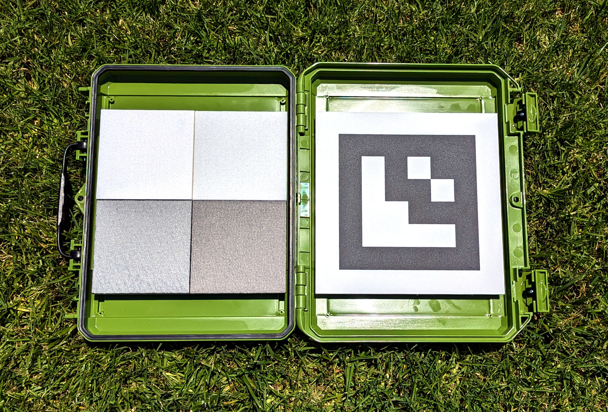

# เป้าหมายการปรับเทียบ

MAPIR มีเป้าหมายการปรับเทียบหลากหลายแบบเพื่อรองรับการใช้งานในหลายด้าน T4-R50 ที่มีขนาดกะทัดรัดดังที่เห็นด้านล่างนี้ ประกอบด้วยแผง 4 แผ่น ซึ่งได้ผ่านการวัดค่าการสะท้อนแสงในช่วงความยาวคลื่น 250 - 2,500 นาโนเมตร

<figure><figcaption>
MAPIR T4-R50
</figcaption></figure>เป้าหมายอ้างอิงการสะท้อนแบบกระจาย T4 มีเส้นโค้งการสะท้อนดังต่อไปนี้, [ดาวน์โหลดข้อมูลที่นี่](https://cdn.shopify.com/s/files/1/0972/5566/files/MAPIR_Diffuse_Reflectance_Standard_Calibration_Target_Data_T4.xlsx?v=1741759157):

<figure><figcaption>
MAPIR T4 การสะท้อน :: 250-2500nm
</figcaption></figure>

<figure><figcaption>
MAPIR T4 Reflectance :: 400-1000nm
</figcaption></figure>เป้าหมายอ้างอิงแบบกระจายแสง T4P มีเส้นโค้งการสะท้อนแสงดังต่อไปนี้ [ดาวน์โหลดข้อมูลที่นี่](https://cdn.shopify.com/s/files/1/0972/5566/files/MAPIR_Diffuse_Reflectance_Standard_Calibration_Target_Data_T4.xlsx?v=1741759157):

<figure><figcaption>
MAPIR T4P Reflectance :: 250-2500nm
</figcaption></figure>

<figure><figcaption>
MAPIR T4P Reflectance :: 400-1000nm
</figcaption></figure>เมื่อดูกราฟการสะท้อนแสง คุณจะเห็นว่าค่าที่แสดงคือความยาวคลื่น (แกน x) เทียบกับเปอร์เซ็นต์การสะท้อนแสง (แกน y) เมื่อเราถ่ายภาพเป้าหมายการปรับเทียบ เราจะสร้างความสัมพันธ์ระหว่างค่าพิกเซลกับเปอร์เซ็นต์การสะท้อนแสง ภายในสเปกตรัมที่แต่ละแถบเซ็นเซอร์ของกล้องมีความไวต่อแสง

ซึ่งหมายความว่า สำหรับภาพทุกภาพที่คุณถ่ายด้วยกล้องของเรา คุณสามารถใช้ภาพของเป้าหมายการสะท้อนแสงของเรา เช่น [T4-R50](https://www.mapir.camera/collections/calibration-targets/products/diffuse-reflectance-standard-calibration-target-package-t3-r50) หรือ [T4-R125](https://www.mapir.camera/collections/multispectral-reflectance-reference-calibration-targets/products/diffuse-reflectance-standard-calibration-target-package-t4-r125) เพื่อปรับเทียบภาพให้สอดคล้องกับค่าการสะท้อนแสง เมื่อปรับเทียบเสร็จแล้ว พิกเซลแต่ละจุดในภาพจะมีค่าเท่ากับเปอร์เซ็นต์การสะท้อนแสง

สำหรับผลลัพธ์ **Survey3** หากส่งออกภาพที่ปรับเทียบแล้วใน Chloros เป็นรูปแบบ JPG หรือ TIFF แบบทั่วไป ค่าเปอร์เซ็นต์การสะท้อนแสงจะถูกคำนวณโดยการหารค่าพิกเซลด้วยความลึกของบิตของรูปแบบภาพ ดังนั้นสำหรับ JPG ให้หารด้วย 255 และสำหรับ TIFF ให้หารด้วย 65,535 คุณยังสามารถเลือกใช้รูปแบบการส่งออก PERCENT ในChloros ได้ ซึ่งแต่ละพิกเซลจะมีค่าอยู่ในช่วง 0.0 ถึง 1.0 (การสะท้อนแสง 0% ถึง 100%) แต่ควรจำไว้ว่าโปรแกรมประมวลผลภาพบางตัวไม่สามารถรับภาพในรูปแบบเปอร์เซ็นต์ (จุดลอยตัว) ได้ และภาพประเภทนี้มีขนาดไฟล์ที่ใหญ่เมื่อเก็บข้อมูล


**ค่าการสะท้อนแสง LATTICE ใช้สเกลพิกเซลที่ต่างกัน** ค่าการสะท้อนแสง LATTICE ถูกเก็บไว้โดยใช้ DN 32768 = 100% (ไม่ใช่ 65535) และทุกไฟล์จะมีแท็ก XMP `Chloros:PixelScale` ที่ระบุสเกลของมัน อ่านแท็กและแบ่งด้วยค่านั้นแทนที่จะสมมติว่าเป็นค่าคงที่ — ดู [รูปแบบภาพผลลัพธ์](output-image-formats.md).


## เป้าหมายการปรับเทียบกับกล้อง LATTICE

สำหรับกล้อง LATTICE เป้าหมายการปรับเทียบ **เป็นตัวเลือก** สำหรับค่าการสะท้อนแสง: Chloros สามารถอ้างอิงค่าการสะท้อนแสงจากความเข้มแสงที่ส่องลง (downwelling irradiance) ที่วัดโดยเซ็นเซอร์แสง DAQ (ρ = π·L/E) แทนได้ การอ้างอิงนี้ถูกเลือกผ่านการตั้งค่าแหล่งที่มาของการสะท้อนแสงของโครงการ ซึ่งกำหนดผ่าน `chloros-cli process --reflectance-source` (GUI ไม่มีตัวเลือกควบคุมสำหรับเรื่องนี้ และใช้ค่าที่เก็บไว้ในโครงการ โดยค่าเริ่มต้นคือ `auto` — ดู [การตั้งค่าโครงการ](project-settings/project-settings.md)):

| ค่า | พฤติกรรม |
| --- | --- |
| `auto` *(ค่าเริ่มต้น)* | เป้าหมายในเฟรมที่ผ่านการตรวจสอบคุณภาพ (QA) เป็น **อ้างอิงสัมบูรณ์**; เมื่อไม่มีเป้าหมายหรือการตรวจสอบคุณภาพ (QA) ล้มเหลวChloros จะใช้การแบ่งสัญญาณลงของ DAQ เป็นค่าอ้างอิงแทน เป้าหมายที่ผ่านการตรวจสอบคุณภาพ (QA) พร้อมด้วยธง (เช่น แผงที่หลุดออก หรือแถบที่ผิดปกติ) จะไม่ได้รับการเลือกโดยอัตโนมัติ: ระบบจะลองใช้ลำดับเป้าหมาย, เป้าหมาย+DAQ และ DAQ เท่านั้น ตามลำดับคะแนนที่วัดได้บนแผงที่เก็บไว้ |
| `target` | เฉพาะเป้าหมายอย่างเคร่งครัด — ไม่มีการแทนที่ด้วย DAQ |
| `daq` | DAQ เป็นหลัก — การวัดลงสู่พื้นผิวเป็นอ้างอิงเสมอ |

พฤติกรรมเป้าหมายเพิ่มเติมสำหรับ LATTICE:

* **รูปทรงเป้าหมาย** — รองรับทั้งแผงที่มีเครื่องหมาย ArUco, แผงที่มี ROI คงที่ และเป้าหมายแบบแถบ; รูปทรงมาจากกำหนดค่าเป้าหมายของโครงการ
* **ข้อมูลเป้าหมายที่วัดต่อหน่วย** — `--target-reflectance-dir DIR` ชี้ไปยังไดเรกทอรีของสแกนการสะท้อนแสงของเป้าหมายที่วัดต่อหน่วย (`<serial>.csv`, ค้นหาตามหมายเลขซีเรียล/QR ของหน่วยเป้าหมาย) หากไม่พบเป้าหมาย Chloros จะใช้สเปกตรัม T3/T4P ตามค่ามาตรฐานแทน
* **การยึดเวลา** — เป้าหมายที่ตรวจพบจะปรับเทียบเฟรมรอบข้างและถูกเก็บไว้ระหว่างการตรวจพบเป้าหมาย

ความหมายของธงทั้งหมดและตัวอย่างอยู่ใน [คู่มืออ้างอิง CLI](reference/cli-reference.md) (ดู "สวิตช์ส่งออกตามผลิตภัณฑ์")

### F988

"ค่าสะท้อนแสง F988 ได้รับการปรับเทียบโดยใช้แผงสะท้อนแสงในฉาก: แบนด์นี้อยู่นอกช่วงที่ปรับเทียบของเซ็นเซอร์แสง DAQ ดังนั้นChloros จะใช้ข้อมูลการจับภาพแผงล่าสุดของคุณและเก็บไว้ระหว่างการตรวจจับแผง"

หาก F988 ทำงานด้วยการปรับเทียบเฉพาะ DAQ, Chloros จะปฏิเสธค่าการสะท้อนแสงที่อิงจาก DAQ สำหรับแถบนั้นและอธิบายเหตุผล (เหตุผลการข้าม `dls-uncalibrated-band-988`); กระบวนการทำงานกับแผงสะท้อนแสงเป็นวิธีที่ได้รับการสนับสนุน

<figure><figcaption>
T4-R125
</figcaption></figure> <figure><figcaption>
T4-R125
</figcaption></figure> <figure><figcaption>
T4-R125
</figcaption></figure>

